# User Management Service

## C3 — Summary

C3 component diagram for SVC-001 (User Management Service), showing REST controllers, application and domain services for registration, lifecycle, and search, plus validation, authorization, repositories, integration adapters, and cross-cutting components with their relationships to the user database, auth service, audit service, and message bus.

## C3 — Insights

- The service cleanly separates HTTP concerns (controllers, validation, error mapping) from application use cases (registration, lifecycle, search) and deeper domain logic (user and search semantics).
- Dedicated repositories for user aggregates, search queries, and status history allow the same relational store to support both transactional updates and efficient indexed search.
- Authorization is centralized in a component that relies on an Auth Service client, keeping JWT and OIDC specifics out of business logic and controllers.
- Domain events (UserCreated, UserStatusChanged) are emitted via a separate event publisher, preparing the service for future event-driven integration without hard-wiring downstream consumers.
- Cross-cutting concerns (logging, metrics, tracing, standardized error responses) are modeled as distinct components to encourage consistent behavior across all endpoints and use cases.

## C3 — Interfaces

### User Management Public REST API (REST over HTTP/JSON)
Primary HTTP interface of the User Management Service, exposing endpoints for self-service registration, administrative user lifecycle management, and administrative user search and filtering.

- POST /users/registration
- GET /admin/users/{id}
- POST /admin/users
- PUT /admin/users/{id}
- PATCH /admin/users/{id}/status
- GET /admin/users
- GET /admin/users/search

### Request Validation Internal Interface (In-process function calls)
Internal interface used by API controllers to perform syntactic and semantic validation of incoming requests, including body, query parameters, and pagination settings before executing use cases.

- validateRegistrationRequest(request)
- validateLifecycleCommand(command)
- validateSearchQuery(queryParams)
- validatePagination(page,size,sort)

### Authorization Evaluation Interface (In-process function calls)
Internal interface that API controllers use to evaluate whether the current caller, based on JWT claims and policies, may perform administrative user operations.

- checkAdminPermission(token,action)
- assertRole(token,requiredRole)
- evaluatePolicy(principal,resource,action)

### Registration Application Service Interface (In-process function calls)
Internal application service interface providing orchestration operations for self-service user registration and initial user record creation.

- registerSelfServiceUser(registrationData)
- createInitialUserRecord(validatedData)
- recordInitialStatus(userId,initialStatus)

### User Lifecycle Application Service Interface (In-process function calls)
Internal application service interface providing operations for administrative user lifecycle management across create, view, update, and status change commands.

- adminCreateUser(adminContext,userData)
- adminUpdateUser(adminContext,userId,updateData)
- changeUserStatus(adminContext,userId,targetStatus)
- getUserForAdmin(adminContext,userId)

### User Search Application Service Interface (In-process function calls)
Internal application service interface that encapsulates execution of keyword-based search, filtering, sorting, and pagination over users for administrative callers.

- searchUsers(adminContext,keyword,filters,sort,pagination)
- listUsers(adminContext,filters,sort,pagination)
- countUsers(adminContext,keyword,filters)

### User Domain Service Interface (In-process function calls)
Domain service interface that encapsulates user lifecycle invariants and rules, ensuring valid transitions and consistent aggregate state.

- validateNewUser(userData)
- applyLifecycleTransition(user,currentStatus,targetStatus)
- ensureUniqueIdentifiers(userData)

### Search Semantics Domain Service Interface (In-process function calls)
Domain service interface capturing reusable search semantics, filter behavior, and sort ordering for user search operations.

- normalizeKeyword(rawKeyword)
- buildFilterCriteria(filterParams)
- determineSortOrder(requestedSort)

### User Repository Interface (ORM-based data access)
Repository abstraction used by application and domain services to create, load, and update user aggregates and related profile data in the User Management Database.

- saveUser(userAggregate)
- findUserById(userId)
- existsByIdentifiers(identifiers)

### User Search Repository Interface (SQL queries with indices)
Repository abstraction focused on efficiently executing indexed search and filter queries over user data in the User Management Database for admin search use cases.

- searchUsersByCriteria(criteria,pagination)
- countUsersByCriteria(criteria)

### User Status History Repository Interface (ORM-based data access)
Repository abstraction for persisting and retrieving user status history records that document lifecycle state changes over time.

- appendStatusHistoryEntry(userId,fromStatus,toStatus,metadata)
- getStatusHistoryForUser(userId)

### Auth Service Client Interface (HTTPS/OIDC)
Integration interface used to interact with the external Auth Service to validate or introspect tokens and obtain public key material for JWT validation.

- getSigningKeys()
- introspectToken(token)
- fetchOpenIdConfiguration()

### Audit Logging Client Interface (HTTPS/JSON or messaging)
Integration interface that sends structured, append-only audit records about user registration and lifecycle operations to the central Audit Logging Service or store.

- recordUserRegistrationAuditEntry(auditRecord)
- recordUserLifecycleAuditEntry(auditRecord)

### User Event Publisher Interface (Message bus producer API)
Messaging interface that publishes user domain events generated by the service so that external consumers can react to changes without direct coupling.

- publishUserCreatedEvent(eventPayload)
- publishUserStatusChangedEvent(eventPayload)

### Logging Component Interface (In-process logging API)
Cross-cutting logging interface used throughout the service to write structured log entries correlated with incoming requests and domain operations.

- logRequest(context,summary)
- logDomainEvent(eventSummary)
- logIntegrationCall(target,summary)

### Metrics and Tracing Interface (Metrics and tracing SDK)
Cross-cutting interface for emitting metrics and distributed tracing information for API calls, searches, and lifecycle operations within the User Management Service.

- recordTimer(metricName,duration,labels)
- incrementCounter(metricName,labels)
- startTraceSpan(name,context)

### Error Handling Interface (In-process function calls)
Cross-cutting interface that converts validation and domain errors into standardized HTTP error responses aligned with platform guidelines.

- toValidationErrorResponse(validationErrors)
- toNotFoundResponse(resourceType,identifier)
- toInternalErrorResponse(correlationId)


## C3 — Relationships

- Self-Registering User -> apiUserController: Submits self-service registration HTTP requests to the User Management Service.
- Administrator -> apiUserController: Invokes administrative lifecycle and search endpoints on the User Management Service.
- apiUserController -> requestValidation: Delegates validation of incoming request payloads and query parameters before executing use cases.
- apiUserController -> authzComponent: Invokes authorization checks for protected administrative operations based on JWT claims.
- apiUserController -> registrationAppService: Calls registration application service methods when handling self-service registration endpoints.
- apiUserController -> lifecycleAppService: Calls lifecycle application service methods for administrative user lifecycle operations.
- apiUserController -> searchAppService: Calls search application service methods to perform administrative user search and listing.
- apiUserController -> errorHandling: Uses centralized error handling to map exceptions to standardized HTTP responses.
- apiUserController -> loggingComponent: Emits structured logs describing incoming API requests and corresponding responses.
- apiUserController -> metricsComponent: Records metrics and tracing information for handled HTTP requests.
- requestValidation -> errorHandling: Signals validation failures so they can be transformed into validation error responses.
- authzComponent -> authClient: Uses the Auth Service Client to validate or introspect tokens and obtain key material.
- authClient -> Auth Service (IdP): Calls the external Auth Service to retrieve OIDC metadata, JWKS, or introspect tokens.
- registrationAppService -> userDomainService: Delegates to the user domain service to enforce registration rules and invariants.
- registrationAppService -> userRepository: Creates new user aggregates in the User Management Database.
- registrationAppService -> statusHistoryRepository: Writes initial user status history records upon successful registration.
- registrationAppService -> auditClient: Sends audit events describing registration operations to the Audit Logging Service.
- registrationAppService -> eventPublisher: Publishes UserCreated events for downstream consumers via the message bus.
- lifecycleAppService -> userDomainService: Uses the user domain service to validate and apply lifecycle state transitions.
- lifecycleAppService -> userRepository: Loads and persists user aggregates when performing lifecycle operations.
- lifecycleAppService -> statusHistoryRepository: Appends status history records for each lifecycle change.
- lifecycleAppService -> auditClient: Sends audit records describing administrative lifecycle operations.
- lifecycleAppService -> eventPublisher: Publishes user status change events for downstream subscribers.
- searchAppService -> searchDomainService: Delegates to the search domain service to interpret keywords, filters, and sort options.
- searchAppService -> searchRepository: Executes search and filter queries over users via the search repository.
- searchAppService -> metricsComponent: Records search-related performance metrics and traces.
- userRepository -> User Management Database: Reads and writes user and profile data in the relational database.
- searchRepository -> User Management Database: Performs indexed read-only queries for search and filtering operations.
- statusHistoryRepository -> User Management Database: Persists and retrieves user status history records.
- eventPublisher -> Message Bus: Publishes user-related domain events for asynchronous processing by other services.
- auditClient -> Audit Logging Service: Sends structured audit logs for user registration and lifecycle actions.
- loggingComponent -> Audit Logging Service: Optionally forwards selected security-relevant log entries to the audit system or pipeline.

## C3 — External dependencies

- Auth Service (IdP): External authentication and authorization service providing OIDC/OAuth2 flows, JWT tokens, and key material for validation.
- User Management Database: Relational database that stores users, profiles, roles, and status history for the User Management Service.
- Message Bus: Asynchronous messaging infrastructure used to publish user domain events such as UserCreated and UserStatusChanged.
- Audit Logging Service: Centralized audit logging capability receiving append-only records for user-related administrative and registration events.

## C3 — Diagram

```mermaid
flowchart TD

subgraph SVC001[User Management Service (SVC-001)]
  API[User API Controllers\n(REST handlers)]
  VAL[Request Validation Component]
  AUTHZ[Authorization Component\n(RBAC / Policy Engine)]

  REG_APP[Registration Application Service]
  LIFE_APP[User Lifecycle Application Service]
  SEARCH_APP[User Search Application Service]

  USER_DOMAIN[User Domain Service]
  SEARCH_DOMAIN[Search Semantics Domain Service]

  USER_REPO[User Repository]
  SEARCH_REPO[User Search Repository]
  STATUS_REPO[User Status History Repository]

  AUTH_CLIENT[Auth Service Client]
  AUDIT_CLIENT[Audit Logging Client]
  EVENT_PUB[User Event Publisher]

  LOGGING[Logging Component]
  METRICS[Metrics & Tracing Component]
  ERR[Error Handling Component]
end

SELF_USER[Self-Registering User]
ADMIN[Administrator]
AUTH_EXT[Auth Service (IdP)]
DB_USER[(User Management Database)]
MSG_BUS[[Message Bus]]
AUDIT_SVC[Audit Logging Service]

SELF_USER -->|Submits registration requests\nHTTPS/JSON| API
ADMIN -->|Admin lifecycle & search calls\nHTTPS/JSON| API

API -->|Validate requests| VAL
API -->|Authorize admin operations| AUTHZ
API -->|Registration use cases| REG_APP
API -->|Lifecycle use cases| LIFE_APP
API -->|Search use cases| SEARCH_APP
API -->|Map errors to responses| ERR
API -->|Write request/response logs| LOGGING
API -->|Record metrics & traces| METRICS

VAL -->|Report validation failures| ERR

AUTHZ -->|Verify tokens / claims| AUTH_CLIENT
AUTH_CLIENT -->|JWKS / introspection\nHTTPS/OIDC| AUTH_EXT

REG_APP -->|Apply registration rules| USER_DOMAIN
REG_APP -->|Create initial user| USER_REPO
REG_APP -->|Record initial status| STATUS_REPO
REG_APP -->|Audit registration| AUDIT_CLIENT
REG_APP -->|Publish UserCreated| EVENT_PUB

LIFE_APP -->|Apply lifecycle rules| USER_DOMAIN
LIFE_APP -->|Load/update users| USER_REPO
LIFE_APP -->|Append status history| STATUS_REPO
LIFE_APP -->|Audit lifecycle changes| AUDIT_CLIENT
LIFE_APP -->|Publish status-change events| EVENT_PUB

SEARCH_APP -->|Apply search & filter semantics| SEARCH_DOMAIN
SEARCH_APP -->|Indexed user queries| SEARCH_REPO
SEARCH_APP -->|Record search metrics| METRICS

USER_REPO -->|CRUD users & profiles| DB_USER
SEARCH_REPO -->|Search over user data| DB_USER
STATUS_REPO -->|Persist status history| DB_USER

EVENT_PUB -->|UserCreated, UserStatusChanged| MSG_BUS
AUDIT_CLIENT -->|Write audit records| AUDIT_SVC
LOGGING -->|Optional security log forwarding| AUDIT_SVC
```

## C4 — Classes

- UserAdminController
- UserSelfRegistrationController
- GlobalExceptionHandler
- UserApplicationService
- UserSearchService
- UserDtoMapper
- ValidationService
- User
- UserId
- Email
- Address
- UserRepository
- UserSearchSpecification
- KeywordSpecification
- StatusFilterSpecification
- RoleFilterSpecification
- JpaUserEntity
- JpaUserRepositoryImpl
- UserEntityMapper
- OutboxEventPublisher
- SearchQueryTimeoutInterceptor
- CreateUserRequest
- UpdateUserRequest
- ChangeUserStatusRequest
- UserSearchRequest
- SelfRegistrationRequest
- SelfRegistrationResponse
- UserResponse
- PagedUserResponse
- ErrorResponse
- UserDto
- RegisterUserCommand
- CreateUserCommand
- UpdateUserCommand
- ChangeUserStatusCommand
- UserSearchQuery
- SecurityConfig
- LoggingFilter
- MetricsConfiguration

## C4 — Summary

Code-level C4 view for SVC-001 User Management Service, focusing on user lifecycle management, self-service registration, and admin search/filter capabilities in a layered Spring Boot-based modular monolith.

## C4 — Insights

- The design follows a layered architecture (presentation, application, domain, infrastructure) with clear package boundaries and dependency direction, matching patterns P-01 and P-03.
- UserAdminController and UserSelfRegistrationController expose admin lifecycle APIs and self-service registration separately, aligning with different consumer groups and authorization policies.
- UserApplicationService centralizes use-case orchestration (create, update, delete, changeStatus, search) and shields controllers from domain and persistence concerns, supporting testable business workflows.
- Domain model centers on the User aggregate with value objects (UserId, Email, Address) and an explicit UserStatus enum to encode lifecycle states (ACTIVE, SUSPENDED, INACTIVE) required by F-05.
- Repositories use the Repository Pattern (P-04) via UserRepository and JpaUserRepositoryImpl, decoupling domain logic from JPA specifics and enabling mock-based unit tests.
- UserSearchSpecification and its concrete implementations (KeywordSpecification, StatusFilterSpecification, RoleFilterSpecification) implement the Specification Pattern (P-06) to support complex admin search and filtering (F-08).
- DTOs and command/query objects separate external API contracts from the domain model (P-05), allowing internal evolution (e.g., additional fields or rules) without breaking clients.
- GlobalExceptionHandler standardizes validation, not-found, authorization, and technical error responses, ensuring consistent behaviour with the structured error handling acceptance criteria and platform standards.
- SearchQueryTimeoutInterceptor and MetricsConfiguration embody performance and observability aspects from F-08 (US-008), enforcing timeouts and capturing metrics without polluting business logic.
- OutboxEventPublisher enables future adoption of the Transactional Outbox Pattern (P-07) and event-driven integrations (P-08) for user lifecycle events such as UserCreated or UserSuspended.

## C4 — Methods

- **?.UserAdminController.createUser**
- **?.UserAdminController.getUserById**
- **?.UserAdminController.listUsers**
- **?.UserAdminController.updateUser**
- **?.UserAdminController.deleteUser**
- **?.UserAdminController.changeStatus**
- **?.UserSelfRegistrationController.register**
- **?.UserApplicationService.createUser**
- **?.UserApplicationService.updateUser**
- **?.UserApplicationService.deleteUser**
- **?.UserApplicationService.changeStatus**
- **?.UserApplicationService.searchUsers**
- **?.UserSearchService.search**
- **?.UserRepository.search**
- **?.JpaUserRepositoryImpl.search**
- **?.User.activate**
- **?.User.suspend**
- **?.User.deactivate**
- **?.UserDtoMapper.fromCreateRequest**
- **?.GlobalExceptionHandler.handleValidation**
- **?.SearchQueryTimeoutInterceptor.applyTimeout**
- **?.SecurityConfig.configureHttp**

## C4 — Data structures

- User
- UserId
- Email
- Address
- CreateUserRequest
- UpdateUserRequest
- ChangeUserStatusRequest
- UserSearchRequest
- SelfRegistrationRequest
- SelfRegistrationResponse
- UserResponse
- PagedUserResponse
- ErrorResponse
- UserDto
- RegisterUserCommand
- CreateUserCommand
- UpdateUserCommand
- ChangeUserStatusCommand
- UserSearchQuery
- JpaUserEntity
- UserStatus
- MetricsConfiguration.userSearchTimer

## C4 — Code relationships

- Controller delegates all admin lifecycle and search operations to application service to keep controllers thin and testable.
- Self-registration flow reuses core application service logic for creating initial user records.
- Application service persists and loads User aggregates through the repository interface, enforcing dependency inversion (domain over infrastructure).
- Delegates complex validation rules for registration and lifecycle changes to a dedicated validation component.
- Maps between domain User objects and DTOs/commands before returning results to controllers.
- Publishes user lifecycle domain events for outbox-based asynchronous processing.
- Executes search queries using specification composition and repository abstraction.
- Builds concrete KeywordSpecification, StatusFilterSpecification, and RoleFilterSpecification instances and composes them for a given query.
- Infrastructure implementation of the domain repository, fulfilling the contract with JPA-based persistence.
- Uses JPA entity for ORM mapping to the relational database.
- Maps between JpaUserEntity and domain User objects on load and save operations.
- User aggregate owns a UserId value object representing its identity.
- User aggregate composes an Email value object for email address semantics and validation.
- User may include an Address value object for contact details.
- KeywordSpecification is a concrete implementation specialized for keyword-based matching.
- StatusFilterSpecification filters users by account status within search queries.
- RoleFilterSpecification filters users by administrator-configured roles.
- Centralized handler creates standardized ErrorResponse objects for various exception types.
- Servlet filter sits in front of controllers, adding logging and correlation context to each request.
- Security configuration restricts access to admin endpoints based on roles and policies.
- Interceptor applies timeouts and cancellation to JPA queries executed by the repository’s search method.

## C4 — Diagram

```mermaid
classDiagram
  class UserAdminController {
    +createUser(request: CreateUserRequest) ResponseEntity~UserResponse~
    +getUserById(id: UUID) ResponseEntity~UserResponse~
    +listUsers(filter: UserSearchRequest) ResponseEntity~PagedUserResponse~
    +updateUser(id: UUID, request: UpdateUserRequest) ResponseEntity~UserResponse~
    +deleteUser(id: UUID) ResponseEntity~void~
    +changeStatus(id: UUID, request: ChangeUserStatusRequest) ResponseEntity~UserResponse~
  }

  class UserSelfRegistrationController {
    +register(request: SelfRegistrationRequest) ResponseEntity~SelfRegistrationResponse~
  }

  class GlobalExceptionHandler {
    +handleValidation(e: MethodArgumentNotValidException) ErrorResponse
    +handleNotFound(e: UserNotFoundException) ErrorResponse
    +handleAccessDenied(e: AccessDeniedException) ErrorResponse
    +handleTechnical(e: Throwable) ErrorResponse
  }

  class UserApplicationService {
    +registerUser(cmd: RegisterUserCommand) UserDto
    +createUser(cmd: CreateUserCommand) UserDto
    +updateUser(cmd: UpdateUserCommand) UserDto
    +deleteUser(userId: UUID) void
    +changeStatus(cmd: ChangeUserStatusCommand) UserDto
    +getUser(userId: UUID) UserDto
    +searchUsers(query: UserSearchQuery) Page~UserDto~
  }

  class UserSearchService {
    +search(query: UserSearchQuery) Page~UserDto~
  }

  class UserDtoMapper {
    +toDto(user: User) UserDto
    +fromCreateRequest(req: CreateUserRequest) CreateUserCommand
    +fromUpdateRequest(id: UUID, req: UpdateUserRequest) UpdateUserCommand
    +fromSelfRegistration(req: SelfRegistrationRequest) RegisterUserCommand
  }

  class ValidationService {
    +validateRegistration(cmd: RegisterUserCommand) void
    +validateLifecycleChange(cmd: ChangeUserStatusCommand) void
  }

  class User {
    -id: UserId
    -name: String
    -city: String
    -email: Email
    -address: Address
    -status: UserStatus
    -createdAt: Instant
    -updatedAt: Instant
    +activate() void
    +suspend() void
    +deactivate() void
    +updateContactDetails(name: String, city: String, email: Email, address: Address) void
  }

  class UserStatus {
  }

  class UserId {
    -value: UUID
    +of(value: UUID) UserId
  }

  class Email {
    -value: String
    +of(value: String) Email
  }

  class Address {
    -line1: String
    -line2: String
    -city: String
    -postalCode: String
    -country: String
  }

  class UserRepository {
    <<interface>>
    +save(user: User) User
    +findById(id: UserId) Optional~User~
    +deleteById(id: UserId) void
    +search(spec: UserSpecification, page: PageRequest) Page~User~
  }

  class UserSearchSpecification {
    <<interface>>
    +toPredicate(root, query, cb) Predicate
  }

  class KeywordSpecification {
    -keyword: String
  }

  class StatusFilterSpecification {
    -statuses: Set~UserStatus~
  }

  class RoleFilterSpecification {
    -roles: Set~String~
  }

  class JpaUserEntity {
    +id: UUID
    +name: String
    +city: String
    +email: String
    +status: String
    +createdAt: Instant
    +updatedAt: Instant
  }

  class JpaUserRepositoryImpl {
    +save(user: User) User
    +findById(id: UserId) Optional~User~
    +deleteById(id: UserId) void
    +search(spec: UserSpecification, page: PageRequest) Page~User~
  }

  class UserEntityMapper {
    +toEntity(user: User) JpaUserEntity
    +toDomain(entity: JpaUserEntity) User
  }

  class OutboxEventPublisher {
    +publish(event: UserDomainEvent) void
  }

  class SearchQueryTimeoutInterceptor {
    +applyTimeout(query) void
  }

  class CreateUserRequest {
    +name: String
    +city: String
    +email: String
  }

  class UpdateUserRequest {
    +name: String
    +city: String
    +email: String
  }

  class ChangeUserStatusRequest {
    +status: String
  }

  class UserSearchRequest {
    +keyword: String
    +statuses: List~String~
    +roles: List~String~
    +page: int
    +size: int
    +sort: String
  }

  class SelfRegistrationRequest {
    +personalDetails: Map~String,Object~
    +organizationalDetails: Map~String,Object~
  }

  class SelfRegistrationResponse {
    +submissionId: String
    +message: String
  }

  class UserResponse {
    +id: UUID
    +name: String
    +city: String
    +email: String
    +status: String
  }

  class PagedUserResponse {
    +items: List~UserResponse~
    +total: long
    +page: int
    +size: int
  }

  class ErrorResponse {
    +code: String
    +message: String
    +details: Map~String,String~
  }

  class UserDto {
    +id: UUID
    +name: String
    +city: String
    +email: String
    +status: String
  }

  class RegisterUserCommand {
    +personalDetails: Map~String,Object~
    +organizationalDetails: Map~String,Object~
  }

  class CreateUserCommand {
    +name: String
    +city: String
    +email: String
  }

  class UpdateUserCommand {
    +id: UUID
    +name: String
    +city: String
    +email: String
  }

  class ChangeUserStatusCommand {
    +id: UUID
    +targetStatus: UserStatus
  }

  class UserSearchQuery {
    +keyword: String
    +statuses: Set~UserStatus~
    +roles: Set~String~
    +page: int
    +size: int
    +sort: String
  }

  class SecurityConfig {
    +configureHttp() void
  }

  class LoggingFilter {
    +doFilter(req, res, chain) void
  }

  class MetricsConfiguration {
    +userSearchTimer: Timer
  }

  UserAdminController --> UserApplicationService
  UserSelfRegistrationController --> UserApplicationService
  UserApplicationService --> UserRepository
  UserApplicationService --> ValidationService
  UserApplicationService --> UserDtoMapper
  UserSearchService --> UserRepository
  UserSearchService --> UserSearchSpecification
  JpaUserRepositoryImpl ..|> UserRepository
  JpaUserRepositoryImpl --> JpaUserEntity
  JpaUserRepositoryImpl --> UserEntityMapper
  UserDtoMapper --> UserDto
  UserDtoMapper --> CreateUserCommand
  UserDtoMapper --> UpdateUserCommand
  UserDtoMapper --> RegisterUserCommand
  UserRepository --> User
  User --> UserId
  User --> Email
  User --> Address
  UserSearchSpecification <|-- KeywordSpecification
  UserSearchSpecification <|-- StatusFilterSpecification
  UserSearchSpecification <|-- RoleFilterSpecification
  GlobalExceptionHandler --> ErrorResponse
  LoggingFilter --> UserAdminController
  SecurityConfig --> UserAdminController
```



## API specification — Endpoints

### GET /health
Returns basic health status for monitoring and orchestration. No authentication required.

### POST /registrations
Accepts validated registration data from the Self-Service Registration UI and creates an initial user record. Covers F-01 requirements around creating an initial user record after validation. Error messages should not expose internal details.

### POST /admin/users
Allows an administrator to create a new user account in a centralized manner as part of lifecycle management (F-05).

### GET /admin/users/{id}
Allows administrators to view user accounts and their current status information (F-05).

### GET /admin/users
Provides a simple paginated list of users for administrative overview. Advanced search and filtering use the /admin/users/search endpoint (F-08).

### PATCH /admin/users/{id}
Enables administrators to update existing user account information (F-05). PATCH is used for partial updates to fields such as profile attributes or organizational details.

### POST /admin/users/{id}/status/activate
Lifecycle operation to activate a user account as part of F-05. Idempotent if user is already active.

### POST /admin/users/{id}/status/suspend
Lifecycle operation to suspend a user account (F-05). Idempotent if user is already suspended.

### POST /admin/users/{id}/status/deactivate
Lifecycle operation to deactivate a user account (F-05). Idempotent if user is already deactivated.

### GET /admin/users/search
Implements admin user search and filtering capabilities (F-08, US-005, US-006, US-007, US-008). Supports keyword search over configured searchable attributes using case-insensitive contains semantics, optional filters, sort options, and server-side pagination.


## API specification — Summary

User Management Service API focusing on self-service registration (F-01), administrative user lifecycle management (F-05), and administrative user search and filtering (F-08). Provides a minimal, resource-oriented REST surface: public registration submission, admin CRUD-like operations on users including lifecycle status transitions, and a robust admin search endpoint with validation, pagination, and performance/error-handling semantics aligned to the given user stories.

## API specification — Insights

- The API deliberately keeps registration as a separate /registrations resource from admin-managed /admin/users to respect the distinction between user-submitted onboarding data and administratively curated user accounts.
- Lifecycle operations (activate, suspend, deactivate) are expressed as dedicated subordinate resources (/admin/users/{id}/status/...) rather than overloading PATCH semantics, making status transitions explicit in logs, audits, and authorization policies.
- The admin search endpoint is read-only and isolated from modification capabilities, reflecting the requirement to keep discovery logically separate from user modification while still sharing the User representation schema.
- Pagination for listing and search uses simple page/pageSize parameters with room for either count-based or token-based approaches; the schema supports both totalItems and nextPageToken so the implementation can evolve without breaking clients.
- The ErrorResponse schema is designed to support both simple backend failures and rich validation feedback (fieldErrors), aligning with the detailed validation and standardized error-handling stories without exposing internal system details.
- Security is intentionally limited to bearer JWTs via OAuth2/OIDC, with RBAC enforced at the /admin/* path; no extra features such as MFA flows or token issuance endpoints are added inside this bounded context, as those are delegated to the central Auth service.
- Health is exposed via a simple /health endpoint without authentication to support infrastructure liveness checks; more detailed metrics or readiness probes can be layered behind internal-only networking if required without changing this public contract.

API version: 1.0.0

## API specification — Data models

### HealthStatus

### RegistrationRequest

### RegistrationCreatedResponse

### User

### AdminUserCreateRequest

### AdminUserUpdateRequest

### UserListResponse

### UserSearchResponse

### ErrorResponse


## API specification — Authentication

- Authorization: {'rules': [{'notes': "Administrative user lifecycle and search endpoints must only be accessible to callers with administrative roles. Read-only operations may also allow 'user.read' if defined by organizational policy.", 'methods': ['GET', 'POST', 'PATCH', 'POST'], 'pattern': '/admin/users.*', 'required_roles': ['user.admin']}]}
- Rate limiting: {'notes': 'Admin search endpoint /admin/users/search should be integrated with platform-level rate-limiting to prevent abuse. Self-service /registrations endpoint should have stricter rate limits and/or CAPTCHA at the edge as per platform standards.'}

## API specification — Error handling

- Use standard HTTP status codes: 200 for successful reads/searches, 201 for creations, 400 for validation and malformed input, 401 for missing/invalid authentication, 403 for insufficient privileges, 404 for not found, 408 for search timeouts, 409 for duplicates, 500 for unexpected server errors, and 503 for backend/service unavailability.
- All error responses MUST use the ErrorResponse envelope with stable machine-readable 'code' values such as 'validation_failed', 'unauthorized', 'forbidden', 'user_not_found', 'duplicate_resource', 'backend_unavailable', 'timeout', etc.
- Validation errors for registration and admin endpoints should populate 'details.fieldErrors' with one entry per invalid field, indicating field, code, and message, and MUST NOT execute backend operations when validation fails.
- Admin search validation (keyword length, disallowed characters, invalid pagination, unsupported sort fields/directions, unsupported filters) returns HTTP 400 with 'code' like 'validation_failed' and explanatory messages; no partial results should be returned.
- For backend timeouts or unavailability during search, return 408 or 503 with 'code' like 'timeout' or 'backend_unavailable', cancel in-flight operations, and NEVER return partial result sets.
- Error messages must avoid leaking internal implementation details, stack traces, internal identifiers, or backend-specific error texts; all such information should remain in server logs correlated via 'traceId'.
- Idempotent lifecycle operations (activate/suspend/deactivate existing state) should still return 200 with the current User representation; they must not treat already-in-target-state as an error.

## OpenAPI specification

```json
openapi: 3.0.3
info:
  title: User Management Service API
  version: 1.0.0
  description: |
    REST API for self-service user registration, administrative user lifecycle
    management, and administrative user search and filtering.
servers:
  - url: https://api.example.com
paths:
  /health:
    get:
      summary: Health Check
      description: Liveness/readiness probe for User Management Service.
      responses:
        '200':
          description: Service is healthy
          content:
            application/json:
              schema:
                $ref: '#/components/schemas/HealthStatus'
  /registrations:
    post:
      summary: Self-Service User Registration
      description: |
        Submit a new self-service registration for a user. Accepts validated
        registration data from the Self-Service Registration UI and creates an
        initial user record. Error messages do not expose internal details.
      requestBody:
        required: true
        content:
          application/json:
            schema:
              $ref: '#/components/schemas/RegistrationRequest'
      responses:
        '201':
          description: Registration accepted and initial user record created
          content:
            application/json:
              schema:
                $ref: '#/components/schemas/RegistrationCreatedResponse'
        '400':
          description: Validation failure for registration input
          content:
            application/json:
              schema:
                $ref: '#/components/schemas/ErrorResponse'
        '409':
          description: Duplicate registration attempt using same identifying information
          content:
            application/json:
              schema:
                $ref: '#/components/schemas/ErrorResponse'
        '503':
          description: Centralized system temporarily unavailable
          content:
            application/json:
              schema:
                $ref: '#/components/schemas/ErrorResponse'
  /admin/users:
    get:
      summary: Admin List Users
      description: |
        Provides a simple paginated list of users for administrative overview.
        Advanced search and filtering use the /admin/users/search endpoint.
      security:
        - OAuth2: []
      parameters:
        - in: query
          name: page
          schema:
            type: integer
            minimum: 1
          required: false
          description: Page index starting at 1.
        - in: query
          name: pageSize
          schema:
            type: integer
            minimum: 1
          required: false
          description: Number of items per page.
      responses:
        '200':
          description: Page of users
          content:
            application/json:
              schema:
                $ref: '#/components/schemas/UserListResponse'
        '400':
          description: Invalid pagination parameters
          content:
            application/json:
              schema:
                $ref: '#/components/schemas/ErrorResponse'
        '401':
          description: Missing or invalid authentication
          content:
            application/json:
              schema:
                $ref: '#/components/schemas/ErrorResponse'
        '403':
          description: Caller lacks administrative privileges
          content:
            application/json:
              schema:
                $ref: '#/components/schemas/ErrorResponse'
    post:
      summary: Admin Create User
      description: |
        Allows an administrator to create a new user account in a centralized
        manner as part of lifecycle management.
      security:
        - OAuth2: []
      requestBody:
        required: true
        content:
          application/json:
            schema:
              $ref: '#/components/schemas/AdminUserCreateRequest'
      responses:
        '201':
          description: User created successfully
          content:
            application/json:
              schema:
                $ref: '#/components/schemas/User'
        '400':
          description: Validation error in user data
          content:
            application/json:
              schema:
                $ref: '#/components/schemas/ErrorResponse'
        '401':
          description: Missing or invalid authentication
          content:
            application/json:
              schema:
                $ref: '#/components/schemas/ErrorResponse'
        '403':
          description: Caller lacks administrative privileges
          content:
            application/json:
              schema:
                $ref: '#/components/schemas/ErrorResponse'
        '409':
          description: User with conflicting unique attributes already exists
          content:
            application/json:
              schema:
                $ref: '#/components/schemas/ErrorResponse'
  /admin/users/{id}:
    get:
      summary: Admin Get User
      description: Allows administrators to view user accounts and current status.
      security:
        - OAuth2: []
      parameters:
        - in: path
          name: id
          required: true
          schema:
            type: string
          description: Unique user identifier.
      responses:
        '200':
          description: User found
          content:
            application/json:
              schema:
                $ref: '#/components/schemas/User'
        '400':
          description: Invalid ID format
          content:
            application/json:
              schema:
                $ref: '#/components/schemas/ErrorResponse'
        '401':
          description: Missing or invalid authentication
          content:
            application/json:
              schema:
                $ref: '#/components/schemas/ErrorResponse'
        '403':
          description: Caller lacks administrative privileges
          content:
            application/json:
              schema:
                $ref: '#/components/schemas/ErrorResponse'
        '404':
          description: User not found
          content:
            application/json:
              schema:
                $ref: '#/components/schemas/ErrorResponse'
    patch:
      summary: Admin Update User
      description: Enables administrators to update existing user account information.
      security:
        - OAuth2: []
      parameters:
        - in: path
          name: id
          required: true
          schema:
            type: string
          description: Unique user identifier.
      requestBody:
        required: true
        content:
          application/json:
            schema:
              $ref: '#/components/schemas/AdminUserUpdateRequest'
      responses:
        '200':
          description: User updated successfully
          content:
            application/json:
              schema:
                $ref: '#/components/schemas/User'
        '400':
          description: Validation error in update payload
          content:
            application/json:
              schema:
                $ref: '#/components/schemas/ErrorResponse'
        '401':
          description: Missing or invalid authentication
          content:
            application/json:
              schema:
                $ref: '#/components/schemas/ErrorResponse'
        '403':
          description: Caller lacks administrative privileges
          content:
            application/json:
              schema:
                $ref: '#/components/schemas/ErrorResponse'
        '404':
          description: User not found
          content:
            application/json:
              schema:
                $ref: '#/components/schemas/ErrorResponse'
  /admin/users/{id}/status/activate:
    post:
      summary: Activate User
      description: Activate a user account. Idempotent if already active.
      security:
        - OAuth2: []
      parameters:
        - in: path
          name: id
          required: tr

_(truncated -- content exceeds the reference file size budget)_
```
