# Store Management Service

## C3 — Summary

C3 component diagram for the Store Management Service (customers, products, orders) showing REST controllers, application services, domain services, repositories, validation/authorization, cross-cutting concerns, and integrations with Auth, Store DB, Audit, and Message Bus.

## C3 — Insights

- The Store Management Service is structured with clear separation between REST controllers, application services, domain services, and repositories to align with a layered, DDD-inspired architecture.
- Auth, validation, and error handling are centralized into dedicated components so customer, product, and order controllers remain thin and focused on mapping HTTP concerns to use cases.
- Customer management explicitly supports soft delete, pagination, and optimistic concurrency using the combination of CustomerRepository, CustomerDomainService, and UnitOfWork.
- Audit logging and event publishing are modeled as separate adapters so they can evolve independently (e.g., switching audit stores or message brokers) without changing core application logic.
- Health checks are implemented via a dedicated controller that directly probes the Store Management Database, supporting the platform-standard health check mechanism specified in the requirements.

## C3 — Interfaces

### Customer Management REST API (REST API (HTTPS, JSON))
External administrative REST interface on the Store Management Service for managing customers, including create, retrieve, list with pagination, update with optimistic concurrency, and soft delete, following the standard JSON error schema and secured for store administrators.

- POST /customers
- GET /customers
- GET /customers/{id}
- PUT /customers/{id}
- DELETE /customers/{id}

### Product Management REST API (REST API (HTTPS, JSON))
External administrative REST interface on the Store Management Service for managing products in the catalog, supporting add, view, update, and delete operations for store administrators.

- POST /products
- GET /products
- GET /products/{id}
- PUT /products/{id}
- DELETE /products/{id}

### Order Management REST API (REST API (HTTPS, JSON))
External administrative REST interface on the Store Management Service for placing, viewing, and deleting orders for specific customers and products when business rules are satisfied.

- POST /orders
- GET /orders
- GET /orders/{id}
- DELETE /orders/{id}

### Health and Readiness API (REST API (HTTPS, JSON))
Technical REST interface exposing liveness and readiness checks for the Store Management Service and its underlying datastore for platform health monitoring.

- GET /health
- GET /health/readiness

### Auth Filter Internal Interface (In-process function calls)
Internal interface through which REST controllers delegate authentication and authorization checks to the filter component using token and role inspection logic.

- Validate access token and signature
- Extract user identity and roles from token
- Enforce store administrator role requirement
- Produce 401 or 403 decisions for the controller

### Request Validation and Normalization Interface (In-process validation library)
Internal interface used by controllers to validate request payloads, headers, and query parameters and to normalize customer and product attributes before passing them to application services.

- Validate JSON structure and content type
- Validate required fields and value formats
- Normalize customer name and city fields
- Validate pagination parameters and limits
- Validate identifier formats and path parameters

### Error Handling and JSON Mapping Interface (In-process error handling)
Internal interface for mapping exceptions and error conditions raised by lower layers into standardized JSON error responses with codes, messages, details, and correlation identifiers.

- Map validation errors to 400 responses
- Map authentication and authorization failures to 401/403
- Map not-found and soft-deleted cases to 404
- Map concurrency conflicts to 409
- Map payload limit violations to 413
- Map media type errors to 415
- Map unexpected failures to 5xx responses

### Customer Application Service Interface (In-process application service)
Internal interface offering customer-focused use cases to controllers, orchestrating domain rules, repositories, concurrency checks, auditing, and transaction boundaries.

- CreateCustomer(command)
- GetCustomerById(query)
- ListActiveCustomers(query)
- UpdateCustomer(command)
- SoftDeleteCustomer(command)

### Product Application Service Interface (In-process application service)
Internal interface exposing product catalog use cases to controllers, coordinating validation, domain rules, persistence, and auditing for product operations.

- AddProduct(command)
- GetProductById(query)
- ListProducts(query)
- UpdateProduct(command)
- DeleteProduct(command)

### Order Application Service Interface (In-process application service)
Internal interface providing order-related use cases to controllers, coordinating validation, domain rules, persistence, auditing, and event publishing for order placement and management.

- PlaceOrder(command)
- GetOrderById(query)
- ListOrders(query)
- DeleteOrder(command)

### Customer Repository Interface (ORM-based repository (SQL))
Data access abstraction for customer aggregates used by the customer application and domain services to persist and retrieve customer data from the store database.

- InsertCustomer(entity)
- FindCustomerById(id)
- ListActiveCustomers(pagedQuery)
- UpdateCustomer(entity, version)
- SoftDeleteCustomer(id, version)

### Product Repository Interface (ORM-based repository (SQL))
Data access abstraction for product entities used by the product application and domain services to persist and retrieve product catalog data.

- InsertProduct(entity)
- FindProductById(id)
- ListProducts(pagedQuery)
- UpdateProduct(entity, version)
- DeleteProduct(id, version)

### Order Repository Interface (ORM-based repository (SQL))
Data access abstraction for orders and related order items used by the order application and domain services to persist and query orders by id, customer, and product.

- InsertOrder(aggregate)
- FindOrderById(id)
- ListOrders(pagedQuery)
- DeleteOrder(id)

### Unit of Work Interface (In-process transaction manager)
Internal interface for managing transactional boundaries and committing or rolling back grouped repository operations for a single business request.

- BeginTransaction()
- CommitTransaction()
- RollbackTransaction()

### Audit Logger Interface (In-process audit adapter)
Internal interface for recording structured audit events whenever customer, product, or order data is created, updated, or deleted by an administrator.

- RecordCustomerChange(event)
- RecordProductChange(event)
- RecordOrderChange(event)

### Domain Event Publisher Interface (In-process message publishing adapter)
Internal interface used by application services to publish significant domain events such as order placement to the message bus for downstream consumers.

- PublishOrderPlaced(event)
- PublishOrderDeleted(event)

### Auth Service External Interface (OIDC discovery and JWT validation)
External interface to the organization-wide authentication and authorization service used by the Store Management Service to validate and interpret JWT access tokens.

- Retrieve JWKS for token validation
- Validate token signatures and expiry
- Resolve token claims and roles

### Store Database External Interface (JDBC/SQL or equivalent relational DB access)
External relational database interface through which repositories persist and query customer, product, order, and order item records with ACID guarantees.

- Execute parameterized SELECT statements
- Execute INSERT, UPDATE, and DELETE statements
- Manage database transactions

### Audit Store External Interface (JDBC/SQL or HTTP API)
External audit store interface used by the audit logging adapter to append immutable audit records for administrative actions on store entities.

- Append audit record for customer change
- Append audit record for product change
- Append audit record for order change

### Message Bus External Interface (Kafka or RabbitMQ client API)
External message bus interface used by the domain event publisher to emit store-related domain events to subscribed downstream services.

- Publish OrderPlaced event to topic
- Publish OrderDeleted or related events to topic


## C3 — Relationships

- Admin -> ApiGatewayAdapter: Store administrator calls Store Management REST APIs via the gateway to manage customers, products, and orders.
- ApiGatewayAdapter -> RestCustomerController: Routes /store/customers* requests into the Customer REST Controller for customer management operations.
- ApiGatewayAdapter -> RestProductController: Routes /store/products* requests into the Product REST Controller for product catalog operations.
- ApiGatewayAdapter -> RestOrderController: Routes /store/orders* requests into the Order REST Controller for order placement and management.
- ApiGatewayAdapter -> HealthController: Routes /store/health* requests into the Health & Readiness Controller for monitoring.
- RestCustomerController -> AuthFilter: Delegates authentication and authorization checks for /customers endpoints to ensure only store administrators are allowed.
- RestProductController -> AuthFilter: Delegates authentication and authorization checks for /products endpoints.
- RestOrderController -> AuthFilter: Delegates authentication and authorization checks for /orders endpoints.
- AuthFilter -> AuthSvc: Validates JWT tokens and retrieves signing keys and claims from the external Auth service.
- RestCustomerController -> RequestValidation: Invokes request validation and normalization for customer payloads, query parameters, and headers.
- RestProductController -> RequestValidation: Invokes request validation for product management requests.
- RestOrderController -> RequestValidation: Invokes request validation for order placement and management requests.
- RestCustomerController -> CustomerAppService: Calls customer use case methods to create, retrieve, list, update, and soft delete customers.
- RestProductController -> ProductAppService: Calls product use case methods to add, view, update, and delete products.
- RestOrderController -> OrderAppService: Calls order use case methods to place, view, and delete orders.
- HealthController -> StoreDb: Performs lightweight queries against the store database to report readiness and health status.
- CustomerAppService -> CustomerDomainService: Delegates enforcement of customer-specific business rules such as normalization, uniqueness, and soft delete behavior.
- ProductAppService -> ProductDomainService: Delegates enforcement of product-specific validation and business rules.
- OrderAppService -> OrderDomainService: Delegates enforcement of order placement and management business rules including reference checks and quantities.
- CustomerAppService -> CustomerRepository: Uses the customer repository to persist and query customer records as part of use case execution.
- ProductAppService -> ProductRepository: Uses the product repository to persist and query product catalog records.
- OrderAppService -> OrderRepository: Uses the order repository to persist and query order aggregates.
- CustomerRepository -> StoreDb: Executes SQL commands to read and write customer data in the store database.
- ProductRepository -> StoreDb: Executes SQL commands to read and write product data in the store database.
- OrderRepository -> StoreDb: Executes SQL commands to read and write order and order item data in the store database.
- CustomerAppService -> UnitOfWork: Begins and completes transactions around customer operations to ensure atomicity.
- ProductAppService -> UnitOfWork: Begins and completes transactions around product operations.
- OrderAppService -> UnitOfWork: Begins and completes transactions around order placement and management operations.
- CustomerAppService -> AuditLogger: Sends structured audit events for customer create, update, and soft delete operations.
- ProductAppService -> AuditLogger: Sends structured audit events for product CRUD operations.
- OrderAppService -> AuditLogger: Sends structured audit events for order placement and deletion.
- AuditLogger -> AuditStore: Persists audit entries to the external audit logging store as append-only records.
- OrderAppService -> EventPublisher: Instructs the event publisher to emit order-related domain events when important state changes occur.
- EventPublisher -> MsgBus: Publishes domain events such as OrderPlaced to the external message bus for asynchronous processing by other services.
- RestCustomerController -> ErrorHandler: Uses centralized error handler to convert exceptions into standard JSON error responses for customer endpoints.
- RestProductController -> ErrorHandler: Uses centralized error handler for product endpoint failures.
- RestOrderController -> ErrorHandler: Uses centralized error handler for order endpoint failures.
- HealthController -> ErrorHandler: Uses centralized error handler for health endpoint failures when applicable.
- RestCustomerController -> LoggingMonitoring: Emits request, response, and timing logs plus metrics for customer APIs.
- RestProductController -> LoggingMonitoring: Emits request, response, and timing logs plus metrics for product APIs.
- RestOrderController -> LoggingMonitoring: Emits request, response, and timing logs plus metrics for order APIs.
- CustomerAppService -> LoggingMonitoring: Emits business-level logs and metrics for customer operations, including performance and error rates.
- ProductAppService -> LoggingMonitoring: Emits business-level logs and metrics for product operations.
- OrderAppService -> LoggingMonitoring: Emits business-level logs and metrics for order operations and performance.

## C3 — External dependencies

- Authentication & Authorization Service: External identity provider and authorization service that issues JWT tokens and provides keys and metadata used to authenticate and authorize Store Management Service calls.
- Store Management Database: Primary relational database that stores customers, products, orders, and related transactional data owned by the Store Management Service.
- Audit Logging Store: Centralized audit store where append-only audit events from the Store Management Service are recorded for compliance and traceability.
- Message Bus / Event Broker: Asynchronous messaging infrastructure that receives domain events such as OrderPlaced from the Store Management Service for downstream consumers like notifications or reporting.
- Store Administrator: Human administrator who uses the admin UI to manage customers, products, and orders via the Store Management Service APIs.

## C3 — Diagram

```mermaid
flowchart TD

    subgraph SVC_002[Store Management Service]
        ApiGatewayAdapter[[API Gateway Adapter]]

        RestCustomerController[[Customer REST Controller]]
        RestProductController[[Product REST Controller]]
        RestOrderController[[Order REST Controller]]
        HealthController[[Health & Readiness Controller]]

        AuthFilter[[Authentication & Authorization Filter]]
        RequestValidation[[Request Validation & Normalization]]
        ErrorHandler[[Error Handling & JSON Error Mapper]]

        CustomerAppService[[Customer Application Service]]
        ProductAppService[[Product Application Service]]
        OrderAppService[[Order Application Service]]

        CustomerDomainService[[Customer Domain Service]]
        ProductDomainService[[Product Domain Service]]
        OrderDomainService[[Order Domain Service]]

        CustomerRepository[[Customer Repository]]
        ProductRepository[[Product Repository]]
        OrderRepository[[Order Repository]]

        UnitOfWork[[Transaction / Unit of Work Manager]]
        AuditLogger[[Audit Logging Adapter]]
        EventPublisher[[Domain Event Publisher]]

        LoggingMonitoring[[Logging & Monitoring Adapter]]
    end

    Admin[Store Administrator]
    AuthSvc[(Auth Service / IdP)]
    StoreDb[(Store Management Database)]
    AuditStore[(Audit Logging Store)]
    MsgBus{{Message Bus}}

    Admin -->|HTTPS/JSON admin calls| ApiGatewayAdapter

    ApiGatewayAdapter -->|/store/customers*| RestCustomerController
    ApiGatewayAdapter -->|/store/products*| RestProductController
    ApiGatewayAdapter -->|/store/orders*| RestOrderController
    ApiGatewayAdapter -->|/store/health*| HealthController

    RestCustomerController --> AuthFilter
    RestProductController --> AuthFilter
    RestOrderController --> AuthFilter

    AuthFilter -->|Validate JWT, roles| AuthSvc

    RestCustomerController -->|validate & normalize| RequestValidation
    RestProductController -->|validate & normalize| RequestValidation
    RestOrderController -->|validate & normalize| RequestValidation

    RestCustomerController -->|invoke use case| CustomerAppService
    RestProductController -->|invoke use case| ProductAppService
    RestOrderController -->|invoke use case| OrderAppService

    HealthController -->|check connectivity| StoreDb

    CustomerAppService -->|customer rules| CustomerDomainService
    ProductAppService -->|product rules| ProductDomainService
    OrderAppService -->|order rules| OrderDomainService

    CustomerAppService -->|CRUD + queries| CustomerRepository
    ProductAppService -->|CRUD| ProductRepository
    OrderAppService -->|CRUD| OrderRepository

    CustomerRepository -->|SQL| StoreDb
    ProductRepository -->|SQL| StoreDb
    OrderRepository -->|SQL| StoreDb

    CustomerAppService -->|transaction boundary| UnitOfWork
    ProductAppService -->|transaction boundary| UnitOfWork
    OrderAppService -->|transaction boundary| UnitOfWork

    CustomerAppService -->|audit customer changes| AuditLogger
    ProductAppService -->|audit product changes| AuditLogger
    OrderAppService -->|audit order changes| AuditLogger

    AuditLogger -->|append audit records| AuditStore

    OrderAppService -->|publish events| EventPublisher
    EventPublisher -->|OrderPlaced events| MsgBus

    RestCustomerController -->|errors -> JSON schema| ErrorHandler
    RestProductController -->|errors -> JSON schema| ErrorHandler
    RestOrderController -->|errors -> JSON schema| ErrorHandler
    HealthController -->|errors -> JSON schema| ErrorHandler

    RestCustomerController -->|log & metrics| LoggingMonitoring
    RestProductController -->|log & metrics| LoggingMonitoring
    RestOrderController -->|log & metrics| LoggingMonitoring
    CustomerAppService -->|business logs & metrics| LoggingMonitoring
    ProductAppService -->|business logs & metrics| LoggingMonitoring
    OrderAppService -->|business logs & metrics| LoggingMonitoring
```



## C4 — Classes

- CustomerController
- ProductController
- OrderController
- GlobalExceptionHandler
- SecurityConfig
- CustomerApplicationService
- ProductApplicationService
- OrderApplicationService
- CustomerValidator
- OrderPlacementPolicy
- CustomerMapper
- ProductMapper
- OrderMapper
- AuditLogger
- Customer
- Product
- Order
- Money
- CustomerId
- ProductId
- OrderId
- CustomerRepository
- ProductRepository
- OrderRepository
- DomainEvent
- CustomerCreatedEvent
- CustomerUpdatedEvent
- CustomerDeletedEvent
- JpaCustomerRepositoryImpl
- JpaProductRepositoryImpl
- JpaOrderRepositoryImpl
- CustomerEntity
- ProductEntity
- OrderEntity
- OutboxEventEntity
- OutboxPublisher
- StoreDbContext

## C4 — Summary

Code-level C4 view of SVC-002 Store Management Service (Spring Boot layered architecture) focusing on customer, product, and order management with REST APIs, application services, rich domain model, repositories, and cross-cutting security and audit logging.

## C4 — Insights

- The service is structured as a classic modular layered architecture (presentation, application, domain, infrastructure) mapped to Spring Boot, aligned with the Store Management bounded context.
- Customer management implements soft delete, optimistic concurrency with version/ETag, and normalized name+city uniqueness, directly reflecting US-009/010/011/012 and F-13 acceptance criteria.
- SecurityConfig centralizes OAuth2/OIDC and role-based authorization so that all /customers, /products, and /orders endpoints enforce admin-only access and return 401/403 with the standard JSON ErrorResponse schema (US-013).
- CustomerApplicationService, ProductApplicationService, and OrderApplicationService act as use-case coordinators, keeping controllers thin and delegating to domain logic and repositories in line with DDD and layered-architecture patterns.
- Domain entities (Customer, Product, Order) encapsulate behavior (update, softDelete, calculateTotal) instead of being anemic, improving testability and enforcing business invariants for order placement and lifecycle rules.
- Value objects (Money, CustomerId, ProductId, OrderId) express important domain concepts like monetary values and opaque identifiers, supporting requirements for URL-safe, non-guessable ids and robust pricing calculations.
- Repository interfaces in the domain layer and JPA-based implementations in the infrastructure layer realize the Repository Pattern (P-04), cleanly separating persistence concerns and enabling mocking in tests.
- CustomerValidator and OrderPlacementPolicy gather cross-entity business rules (validation, paging limits, basic order conditions) that are referenced in acceptance criteria, avoiding duplication across controllers and services.
- DTOs, request/response models, and dedicated mappers (CustomerMapper, ProductMapper, OrderMapper) implement the DTOs and Mappers pattern (P-05), decoupling external REST contracts from internal aggregates.
- OutboxEventEntity and OutboxPublisher illustrate the Transactional Outbox pattern (P-07) for emitting domain events like CustomerCreatedEvent to the message bus while staying consistent with the database and supporting future event-driven integrations.
- GlobalExceptionHandler standardizes error responses across all endpoints, ensuring every error path returns the JSON error schema with code, message, details, and correlationId as required by several customer-management stories.
- AuditLogger abstracts audit logging of create/update/delete operations with actor identity, operation type, and change summaries, satisfying US-013 while keeping audit concerns out of core business services.

## C4 — Methods

- **CustomerController.?**
- **CustomerController.?**
- **CustomerController.?**
- **CustomerController.?**
- **CustomerController.?**
- **OrderController.?**
- **CustomerApplicationService.?**
- **CustomerApplicationService.?**
- **CustomerApplicationService.?**
- **OrderApplicationService.?**
- **CustomerValidator.?**
- **CustomerValidator.?**
- **OrderPlacementPolicy.?**
- **CustomerRepository.?**
- **JpaCustomerRepositoryImpl.?**
- **AuditLogger.?**
- **GlobalExceptionHandler.?**
- **GlobalExceptionHandler.?**
- **GlobalExceptionHandler.?**
- **OutboxPublisher.?**
- **Money.?**

## C4 — Data structures

- CreateCustomerRequest
- UpdateCustomerRequest
- CustomerResponse
- CreateProductRequest
- ProductResponse
- PlaceOrderRequest
- OrderResponse
- PagedResponse<T>
- CustomerDto
- ProductDto
- OrderDto
- CreateCustomerCommand
- UpdateCustomerCommand
- DeleteCustomerCommand
- ListCustomersQuery
- ErrorResponse
- OutboxEventEntity

## C4 — Code relationships

- Controller delegates all customer-related business operations to CustomerApplicationService, keeping HTTP concerns separate from domain logic.
- Exceptions thrown from controller or downstream layers are intercepted by GlobalExceptionHandler to produce standardized ErrorResponse objects.
- SecurityConfig applies authentication and authorization filters to all /customers endpoints, enforcing admin-only access and 401/403 responses.
- Service layer persists and retrieves Customer aggregates exclusively through the CustomerRepository interface, not through entities or ORM directly.
- All customer create/update/list operations invoke CustomerValidator to enforce field- and paging-level rules before mutating state.
- Mapping between commands, domain aggregates, and DTOs is centralized in CustomerMapper so application service remains orchestration-focused.
- After successful create, update, or delete operations, the service calls AuditLogger to record audit entries according to US-013.
- Repository implementation converts between domain Customer and JPA CustomerEntity to perform database CRUD operations via JPA/EntityManager.
- Customer aggregate holds a CustomerId value object, encapsulating opaque identifier behavior and validation.
- Order uses Money value objects for unitPrice and totalPrice, ensuring proper monetary calculations and avoiding primitive obsession.
- Service consults the policy to validate cross-aggregate constraints (customer, product, quantity) before creating an Order.
- Order placement and listing operations load customers to verify existence and state, maintaining consistency with customer soft delete behavior.
- Order placement logic queries products to confirm they exist and to obtain latest pricing via ProductRepository.
- AuditLogger may use OutboxPublisher to persist audit events into the transactional outbox for asynchronous processing and durable audit storage.
- OutboxPublisher creates OutboxEventEntity records as part of the same transaction that changes domain aggregates, realizing the Transactional Outbox pattern.

## C4 — Diagram

_(diagram omitted -- exceeds the reference file size budget)_

## API specification — Endpoints

### GET /health
Returns overall health status of the Store Management Service and its primary datastore, suitable for platform-standard health monitoring.

### POST /customers
Creates a new customer with name and city. Enforces validation, normalization, and opaque URL-safe identifier generation.

### GET /customers
Retrieves a paginated list of active (non-soft-deleted) customers.

### GET /customers/{id}
Retrieves a single active (non-soft-deleted) customer by id.

### PUT /customers/{id}
Updates an existing active customer’s name and/or city. Enforces validation, normalization, uniqueness on normalized name+city among active customers, and optimistic concurrency via If-Match header.

### DELETE /customers/{id}
Performs a logical (soft) delete of an existing active customer. Requires If-Match for optimistic concurrency and treats soft-deleted customers as non-existent for subsequent reads.

### POST /products
Adds a new product with name and price to the product catalog.

### GET /products
Retrieves products from the product catalog. Pagination is supported; filtering and sorting are out of scope unless added later.

### GET /products/{id}
Retrieves a single product by id.

### PUT /products/{id}
Updates an existing product’s name and/or price.

### DELETE /products/{id}
Deletes a product from the catalog. Detailed behavior regarding products used in orders requires stakeholder input and is not further specified here.

### POST /orders
Places an order for a specified customer and product with a given quantity, enforcing basic business conditions (valid customer, valid product, and valid quantity).

### GET /orders
Retrieves orders. Supports optional filtering by customerId and/or productId. Pagination is supported for tracking what each customer has ordered.

### GET /orders/{id}
Retrieves a single order by id.

### DELETE /orders/{id}
Deletes an order by id when needed by store administrators. Business behavior regarding physical vs soft delete is not specified and can be refined later.


## API specification — Summary

REST API specification for the Store Management Service covering customer, product, and order management with OAuth2-based admin access, standard error handling, and health checks.

## API specification — Insights

- Customer endpoints implement soft delete and optimistic concurrency with ETags, ensuring downstream systems can treat deleted customers as non-existent while avoiding lost updates.
- A single OAuth2 client-credentials flow with a store.admin scope keeps authorization simple and aligned with the store administrator role described in the requirements.
- Standardized ErrorResponse with correlationId across all endpoints improves observability, debugging, and supports centralized logging and tracing.
- Pagination with explicit limits (pageSize max 100) and 413 handling ensures the service can protect itself and clients from large payloads while remaining predictable.
- The OpenAPI spec focuses strictly on CRUD and business operations explicitly required by F-13, F-14, and F-15, avoiding speculative features like MFA, HATEOAS links, or complex search/filter semantics.
- Health check design accounts for both API liveness and datastore availability, supporting the 99.5% uptime monitoring requirement.

API version: 1.0.0

## API specification — Data models

### CustomerCreateRequest

### CustomerUpdateRequest

### CustomerResponse

### CustomerPageResponse

### ProductCreateRequest

### ProductUpdateRequest

### ProductResponse

### ProductPageResponse

### OrderCreateRequest

### OrderResponse

### OrderPageResponse

### ErrorResponse

### HealthCheckResponse


## API specification — Authentication

- Rate limiting: {'headers': ['X-RateLimit-Limit', 'X-RateLimit-Remaining', 'Retry-After'], 'policy_summary': 'Enforced at API Gateway; specific limits to be defined with platform team (e.g., requests per minute per client).'}

## API specification — Error handling

- The API uses standard HTTP status codes to reflect the outcome of operations: 2xx for success, 4xx for client errors (validation, authentication, authorization, not found, conflicts), and 5xx for server or dependency failures.
- All error responses use the standard ErrorResponse JSON schema with fields: code, message, details, correlationId. The correlationId must be non-empty for all error responses.
- Authentication failures: 401 Unauthorized when the caller is not authenticated or the token is invalid; 403 Forbidden when the caller is authenticated but does not have the required store administrator role/scope.
- Validation errors (e.g., missing name or city, invalid id format, pageSize exceeding maximum, malformed JSON) return 400 Bad Request with details explaining the specific validation issues.
- Unsupported or missing Content-Type when a JSON body is required results in 415 Unsupported Media Type, using the standard error schema.
- Requests that reference non-existent or soft-deleted customers, products, or orders return 404 Not Found with the standard error schema. Soft-deleted customers must not be distinguishable from non-existent ones.
- Concurrency conflicts (e.g., stale If-Match ETag on customer update or delete) and uniqueness violations (e.g., duplicate normalized name+city) return 409 Conflict with an appropriate error code and message.
- When the request body or computed response payload would exceed configured limits, the API returns 413 Payload Too Large with an ErrorResponse body.
- Backend datastore unavailability or other dependency failures should surface as 503 Service Unavailable (or 500 for unexpected conditions) along with ErrorResponse including a correlationId for troubleshooting.

## OpenAPI specification

```json
openapi: 3.0.3
info:
  title: Store Management Service API
  version: 1.0.0
  description: |
    Provides store administration capabilities for managing customers, products,
    and orders via REST APIs. Supports customer lifecycle with soft delete and
    optimistic concurrency, basic product catalog CRUD, and order placement,
    viewing, and deletion within a single store management bounded context.
servers:
  - url: https://api.example.com/store
paths:
  /health:
    get:
      tags: [System]
      summary: Health check
      description: Returns overall health status of the Store Management Service and its primary datastore.
      operationId: getHealth
      responses:
        '200':
          description: Service is healthy
          content:
            application/json:
              schema:
                $ref: '#/components/schemas/HealthCheckResponse'
        '503':
          description: Service or one of its dependencies is unhealthy
          content:
            application/json:
              schema:
                $ref: '#/components/schemas/HealthCheckResponse'
  /customers:
    post:
      tags: [Customers]
      summary: Create customer
      description: |
        Creates a new customer with name and city. Enforces validation,
        normalization, and opaque URL-safe identifier generation.
      operationId: createCustomer
      security:
        - oauth2-client-credentials: [store.admin]
      requestBody:
        required: true
        content:
          application/json:
            schema:
              $ref: '#/[REDACTED-AWS_SECRET_KEY]'
      responses:
        '201':
          description: Customer created successfully
          headers:
            Location:
              description: URI of the created customer resource
              schema:
                type: string
          content:
            application/json:
              schema:
                $ref: '#/components/schemas/Customer'
        '400':
          description: Validation error or malformed JSON
          content:
            application/json:
              schema:
                $ref: '#/components/schemas/ErrorResponse'
        '401':
          description: Caller is not authenticated
          content:
            application/json:
              schema:
                $ref: '#/components/schemas/ErrorResponse'
        '403':
          description: Caller is authenticated but not authorized as store administrator
          content:
            application/json:
              schema:
                $ref: '#/components/schemas/ErrorResponse'
        '413':
          description: Payload too large
          content:
            application/json:
              schema:
                $ref: '#/components/schemas/ErrorResponse'
        '415':
          description: Unsupported media type (only application/json allowed)
          content:
            application/json:
              schema:
                $ref: '#/components/schemas/ErrorResponse'
        '500':
          description: Unexpected server error
          content:
            application/json:
              schema:
                $ref: '#/components/schemas/ErrorResponse'
        '503':
          description: Service unavailable or datastore unavailable
          content:
            application/json:
              schema:
                $ref: '#/components/schemas/ErrorResponse'
    get:
      tags: [Customers]
      summary: List active customers (paged)
      description: Retrieves a paginated list of active (non-soft-deleted) customers.
      operationId: listCustomers
      security:
        - oauth2-client-credentials: [store.admin]
      parameters:
        - in: query
          name: page
          description: 1-based page index
          required: false
          schema:
            type: integer
            minimum: 1
            default: 1
        - in: query
          name: pageSize
          description: Number of items per page (must not exceed configured maximum)
          required: false
          schema:
            type: integer
            minimum: 1
            maximum: 100
            default: 20
      responses:
        '200':
          description: Page of customers returned successfully
          content:
            application/json:
              schema:
                $ref: '#/components/schemas/CustomerPage'
        '400':
          description: Invalid query parameters (e.g., pageSize > max)
          content:
            application/json:
              schema:
                $ref: '#/components/schemas/ErrorResponse'
        '401':
          description: Caller is not authenticated
          content:
            application/json:
              schema:
                $ref: '#/components/schemas/ErrorResponse'
        '403':
          description: Caller is authenticated but not authorized as store administrator
          content:
            application/json:
              schema:
                $ref: '#/components/schemas/ErrorResponse'
        '413':
          description: Payload too large (response would exceed configured limits)
          content:
            application/json:
              schema:
                $ref: '#/components/schemas/ErrorResponse'
        '500':
          description: Unexpected server error
          content:
            application/json:
              schema:
                $ref: '#/components/schemas/ErrorResponse'
        '503':
          description: Service unavailable or datastore unavailable
          content:
            application/json:
              schema:
                $ref: '#/components/schemas/ErrorResponse'
  /customers/{id}:
    get:
      tags: [Customers]
      summary: Get customer by id
      description: Retrieves a single active (non-soft-deleted) customer by id.
      operationId: getCustomerById
      security:
        - oauth2-client-credentials: [store.admin]
      parameters:
        - in: path
          name: id
          description: Opaque, URL-safe customer identifier
          required: true
          schema:
            type: string
      responses:
        '200':
          description: Customer found
          content:
            application/json:
              schema:
                $ref: '#/components/schemas/Customer'
        '400':
          description: Invalid customer id format
          content:
            application/json:
              schema:
                $ref: '#/components/schemas/ErrorResponse'
        '401':
          description: Caller is not authenticated
          content:
            application/json:
              schema:
                $ref: '#/components/schemas/ErrorResponse'
        '403':
          description: Caller is authenticated but not authorized as store administrator
          content:
            application/json:
              schema:
                $ref: '#/components/schemas/ErrorResponse'
        '404':
          description: Customer not found or soft-deleted
          content:
            application/json:
              schema:
                $ref: '#/components/schemas/ErrorResponse'
        '500':
          description: Unexpected server error
          content:
            application/json:
              schema:
                $ref: '#/components/schemas/ErrorResponse'
        '503':
          description: Service unavailable or datastore unavailable
          content:
            application/json:
              schema:
                $ref: '#/components/schemas/ErrorResponse'
    put:
      tags: [Customers]
      summary: Update customer
      description: |
        Updates an existing active customer’s name and/or city. Enforces validation,
        normalization, uniqueness on normalized name+city among active customers,
        and optimistic concurrency via If-Match header.
      operationId: updateCustomer
      security:
        - oauth2-client-credentials: [store.admin]
      parameters:
        - in: path
          

_(truncated -- content exceeds the reference file size budget)_
```
